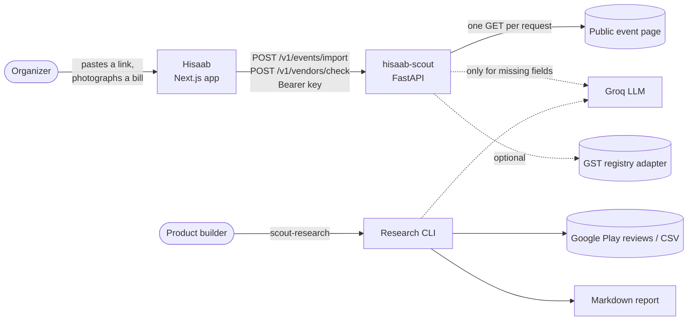
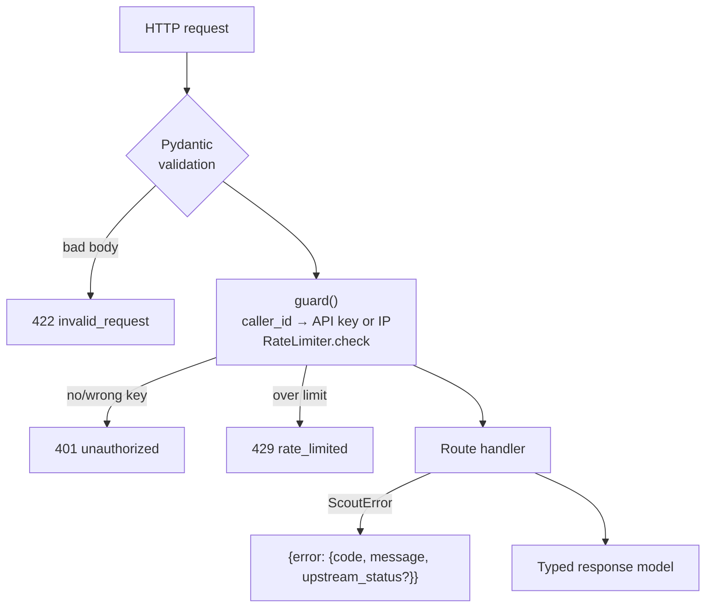
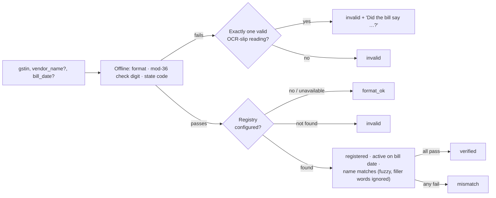
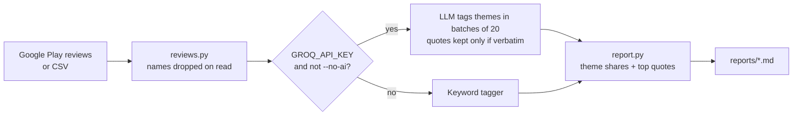
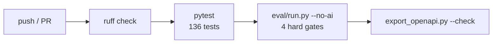

# Architecture: hisaab-scout

hisaab-scout is a small, stateless FastAPI service plus a command-line research tool. [Hisaab](https://github.com/kanugurajesh/Hisaab) calls it server to server. One rule shapes the design: **the model reads, and code decides.** Every value an AI returns has to be backed by a quote from the page, and only code assigns confidence levels and verdicts.

See the [PRD](PRD.md) for why the service exists and the [README](../README.md) for usage.

## System context



- **Caller:** only Hisaab's server. Requests are authenticated with `Authorization: Bearer <key>` whenever `SCOUT_API_KEYS` is set.
- **State:** none is persisted. Import results sit in a 15-minute in-memory cache, and the rate limiter is an in-memory sliding window. Both assume a single instance, which is what Render's free tier runs.
- **Contract:** `openapi.json` is generated from the code (`scripts/export_openapi.py`). CI fails if the two drift apart, and Hisaab generates its TypeScript types from that file.

## Module map

```
src/scout/
├── main.py            App factory: routes, error envelope, auth + rate-limit guard, lifespan wiring
├── config.py          Settings from env / .env (pydantic-settings)
├── errors.py          ScoutError: stable code + organizer-facing message + HTTP status
├── security.py        Bearer-key check (constant-time) and per-caller sliding-window rate limit
├── fetch.py           SSRF-safe single-page fetch, URL normalization (also the cache key)
├── llm.py             One structured LLM call (Groq, strict JSON schema) + deterministic mock
├── events/
│   ├── importer.py    Orchestrates an import: cache → fetch → structured → OG tags → AI → warnings
│   ├── structured.py  schema.org Event from JSON-LD (with repair) or microdata; page meta / OG tags
│   ├── normalize.py   Dates (IST), prices (₹, tiers, paise), venue line, text and title cleanup
│   ├── llm_extract.py Visible-text extraction, AI prompt, and the grounding checks on every value
│   └── models.py      Request/response models (Extracted[T] = value + source + confidence + evidence)
├── vendors/
│   ├── gstin.py       GSTIN format, mod-36 check digit, state/entity decode, OCR-slip fix suggestion
│   ├── registry.py    Registry protocol + FixtureRegistry (demo data, always labelled)
│   ├── check.py       Builds the checks list and decides the verdict
│   └── models.py      Request/response models
└── research/
    ├── cli.py         `scout-research playstore|csv`
    ├── reviews.py     Google Play scraper / CSV loader (drops reviewer names on read)
    ├── classify.py    Theme tagging: LLM with verbatim-quote check, or keyword fallback
    └── report.py      Markdown report: theme shares and top quotes
```

## Request lifecycle

Both endpoints go through the same layers:



Every failure is raised as a `ScoutError` and rendered in a single envelope. The `code` is stable so the frontend can switch on it, and the `message` is written for the organizer.

## Event import pipeline

`EventImporter.import_url` (in `events/importer.py`) runs each step in order and stops trusting sources as it goes down the list:

```mermaid
flowchart TB
    url[Pasted URL] --> norm["normalize_url<br/>https://, lowercase host,<br/>strip fragment + utm/fbclid…"]
    norm --> cache{TTL cache<br/>15 min}
    cache -- hit --> out
    cache -- miss --> fetch

    subgraph fetch [fetch_page — SSRF-safe]
        direction TB
        chk["check_url on every hop<br/>http(s), ports 80/443, no creds,<br/>all resolved IPs public"] --> get[GET, no auto-redirect]
        get -- 3xx --> chk
        get --> lim["HTML only · ≤ 2 MB · 10 s · ≤ 5 redirects"]
    end

    fetch --> parse["structured.parse<br/>JSON-LD → microdata → page meta"]
    parse --> order["Order events: next upcoming first;<br/>rest become alternatives"]
    order --> hi["Structured fields<br/>confidence: high"]
    hi --> og["Fill gaps from OG / meta tags<br/>confidence: medium"]
    og --> gaps{Core fields<br/>still missing?}
    gaps -- no --> warn
    gaps -- yes --> ai

    subgraph ai [AI fallback — llm_extract]
        direction TB
        txt["page_text: drop scripts, nav, footer<br/>and hidden elements · 8 000 chars"] --> call["One Groq call, strict JSON schema<br/>value + evidence quote per field"]
        call --> ground["ground(): quote must be on the page<br/>and support the value<br/>(day+month, hour+am/pm, money word+number)"]
        ground -- fails --> drop[Dropped, logged as rejected]
        ground -- passes --> med["confidence: medium<br/>evidence attached"]
    end

    ai --> warn["Warnings: past / far future, cancelled,<br/>free, online, not rupees, several prices,<br/>login wall, instructions_for_ai, ai_unavailable"]
    warn --> needs["needs_confirmation =<br/>every field that isn't high confidence"]
    needs --> out[ImportResponse]
```

Design points:

- **Confidence comes from the source.** schema.org data is `high`. OG tags, `<title>` and AI values are `medium`. A structured time with no timezone is assumed to be IST, gets downgraded to `medium`, and raises `timezone_assumed`.
- **AI is only a fallback.** It runs only when one of `name`, `date`, `venue` or `per_head_amount` is still missing and wasn't expected to be missing (an online event has no venue, and a free event has no amount). The AI can also replace a weak name taken from a bare `<title>`, but it never overwrites structured data.
- **Prompt-injection defence:** hidden text never reaches the model. Text addressed to AI readers raises `instructions_for_ai` on the form. Any value the model is steered into still has to pass the grounding checks.
- **Graceful degradation:** with no key, an expired key, or a Groq outage, the import still returns the structured fields and adds `ai_unavailable`. Only malformed model output is retried, and only once.
- **Pages that aren't events:** if the model says the page isn't an event and there's no structured Event data, its values are thrown away.

## Vendor check



- **Registry:** a `Registry` is a protocol with a single method, `lookup(gstin)`. `FixtureRegistry` serves the demo data in `data/gst_registry_demo.json` and labels every response from it as demo data. A licensed GSP or paid GSTIN API would plug in as another class. The government portal is never scraped, because it's behind a captcha.
- **Fix suggestions:** a fix is offered only when exactly one corrected reading passes the check digit. The eval gate allows 0 wrong suggestions in 2,000 trials.

## Research CLI



This is a CLI rather than an endpoint because it reads hundreds of reviews in one run. Exposed as an endpoint, it would be slow and easy to abuse.

## LLM layer

`llm.py` exposes one interface, `StructuredLlm.call(task, schema, messages, mock)`:

- The model is called with Groq's strict `json_schema` response format. The schema is generated from a Pydantic model and tightened so every property is required and no extra properties are allowed.
- The response is validated again with Pydantic. Malformed output is retried once, but auth, network and rate-limit errors are not.
- With `AI_MOCK=true`, the mock that each caller passes in is returned without touching the network. Tests and offline demos use this.
- `make_llm` returns `None` when there's no key, and callers then skip the AI step instead of failing.
- Each call records latency, token counts and errors in `CallStats`.

## Security

| Threat | Control | Where |
|---|---|---|
| SSRF through a pasted URL | http(s) only, ports 80/443, no credentials; `localhost`/`.local`/`.internal` blocked; every resolved IP must be global (IPv4-mapped IPv6 is unwrapped); re-checked on every redirect hop | `fetch.py` |
| Resource exhaustion | 2 MB streaming cap, 10 s timeout, 5 redirects, HTML only | `fetch.py` |
| Abuse of the API | Bearer keys compared in constant time; 30 req/min per key, or per IP when open | `security.py` |
| Prompt injection | Hidden text stripped; injection phrasing flagged; every AI value grounded in a quote | `llm_extract.py` |
| AI hallucination | Quote must be on the page and support the value; AI is never `high` confidence | `llm_extract.py`, `importer.py` |
| Demo data mistaken for real | `registry.source = "demo_fixture"` and "(Demo registry.)" in every summary | `vendors/check.py` |

**Known gap:** DNS rebinding. The host is resolved and checked, and then httpx resolves it again to connect. The fix is to connect directly to the IP that was checked. This is tracked in the PRD's risks section.

## Testing and CI



- **Unit tests** (`tests/`) cover SSRF cases, parsing, grounding, importer paths, GSTIN math, auth, rate limiting and research quotes. Tests inject a fake `fetcher`, `resolver`, `transport` and `clock`, so no test touches the network.
- **Eval** (`eval/`) runs 16 synthetic pages and 2,000 GSTIN trials. It exits with code 1 if any of these gates breaks: a wrong `high` field, an AI value without its quote, the injection page importing ₹1, or a wrong GSTIN fix.

## Deployment

- **Render:** `render.yaml` deploys the service as a free web service in Singapore, the same region as Hisaab, and generates `SCOUT_API_KEYS`.
- **Docker:** the `Dockerfile` runs the same app anywhere else.
- **Footprint:** the service runs as a single process with no database and no background jobs. One import is at most one page fetch plus one LLM call, so it fits in a single synchronous request.
- **Scaling beyond one instance:** this would need a shared store, such as Redis, for the cache and the rate limiter.
